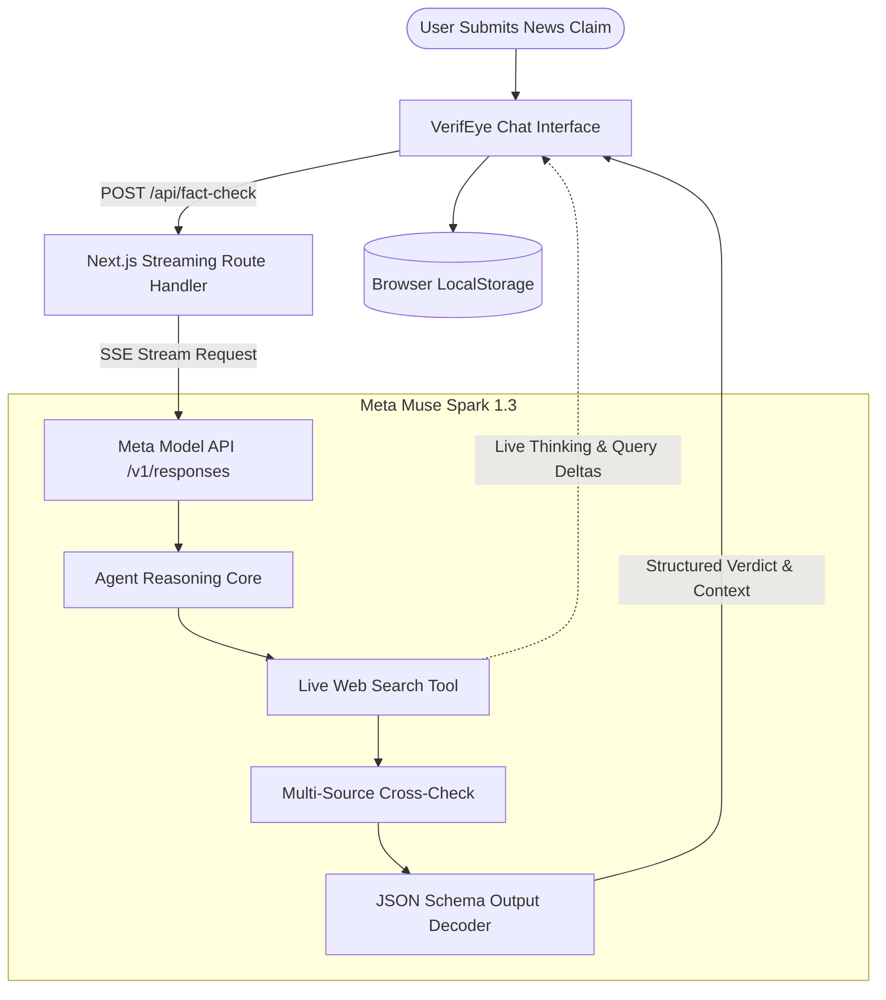

# VerifEye
### Live AI News Fact-Checker and Multi-Source Claim Dissector
> Built for the **Meta Global AI Developer Hackathon**

VerifEye is an AI-powered verification platform engineered to combat misinformation, sensationalized headlines, and unverified digital claims in real time. Powered by Meta's **`muse-spark-1.3-contributor`** reasoning model, VerifEye leverages autonomous web search grounding, live agent thinking streaming, and structured schema evaluation to deliver accurate truth assessments with multi-source corroboration.

---

## Key Highlights

- **Meta Muse Spark 1.3 (`muse-spark-1.3-contributor`)**: Directly connects to Meta's flagship reasoning model configured with `temperature: 1`, `top_p: 1`, `max_output_tokens: 32000`, and `reasoning_effort: medium`.
- **Autonomous Live Web Search Grounding**: Employs Meta's native `web_search` tool (`search_context_size: "medium"`) to query primary news wires, institutional disclosures, and cross-reference multiple independent sources.
- **Live Agent Thinking Streaming**: Real-time Server-Sent Events (SSE) stream the model's intermediate search queries and reasoning thoughts directly into the response bubble (*"Searching: NASA Artemis 1 launch date 2022"*, *"Analyzing wire reports..."*).
- **3-Split Truth Assessment Bar**: High-contrast visual indicator highlighting the verified verdict:
  - **`True`**: Verified by primary sources and institutional announcements.
  - **`Needs Context`**: Emerging developments, omitted qualifiers, or pending confirmation.
  - **`False`**: Debunked assertions or unsubstantiated viral claims.
- **Structured Output via JSON Schema**: Enforces strict decoder-level schema validation returning typed status and corroboration context without post-hoc text parsing.
- **LocalStorage Chat Persistence**: Single persistent chat history stored locally in browser storage with instant synchronization across tabs and page reloads.
- **Modern Light UI**: High-contrast light theme built with React 19, Next.js 16, Lucide icons, and zero layout shift.

---

## System Architecture



---

## Getting Started

### 1. Prerequisites

- **Node.js** 18.17 or later
- **npm**, **yarn**, or **pnpm**
- A Meta Model API Key

### 2. Clone and Install Dependencies

```bash
git clone https://github.com/your-username/verifeye.git
cd verifeye
npm install
```

### 3. Environment Variables Configuration

Create a `.env.local` file in the root directory:

```env
META_MODEL_API_KEY="your_meta_model_api_key_here"
META_MODEL_API_URL="https://api.meta.ai/v1"
META_MODEL_NAME="muse-spark-1.3-contributor"
```

### 4. Run the Development Server

```bash
npm run dev
```

Open [http://localhost:3000](http://localhost:3000) in your browser.

---

## Sample Claims for Testing

| Claim | Expected Verdict | Reason |
|---|---|---|
| *"NASA launched the Artemis I mission to the Moon in November 2022."* | **True** | Corroborated by official NASA mission records and flight telemetry. |
| *"Cochin International Airport in Kerala is the world's first fully solar-powered airport."* | **True** | Verified by UN Champions of the Earth recognition and CIAL filings. |
| *"NASA confirmed Earth will experience 15 days of complete darkness this November."* | **False** | Recurring viral hoax with zero astronomical or institutional substantiation. |
| *"Scientists have successfully cloned a live woolly mammoth and will release a herd into Siberia next month."* | **False** | De-extinction genetic editing research is active, but no live specimen has been birthed or scheduled for release. |

---

## Tech Stack

- **Framework**: [Next.js 16](https://nextjs.org/) (App Router & React Server Components)
- **Library**: [React 19](https://react.dev/)
- **Language**: [TypeScript 5](https://www.typescriptlang.org/)
- **AI Model**: [Meta Muse Spark 1.3](https://dev.meta.ai/models/muse-spark) (`muse-spark-1.3-contributor`)
- **Search Tool**: Meta Native `web_search` with medium context size
- **Streaming**: Server-Sent Events (SSE) via Web Streams API
- **Icons**: [Lucide React](https://lucide.dev/)
- **Styling**: Vanilla CSS Design System with custom micro-animations

---

## License

This project was developed for the Meta Global AI Developer Hackathon.
